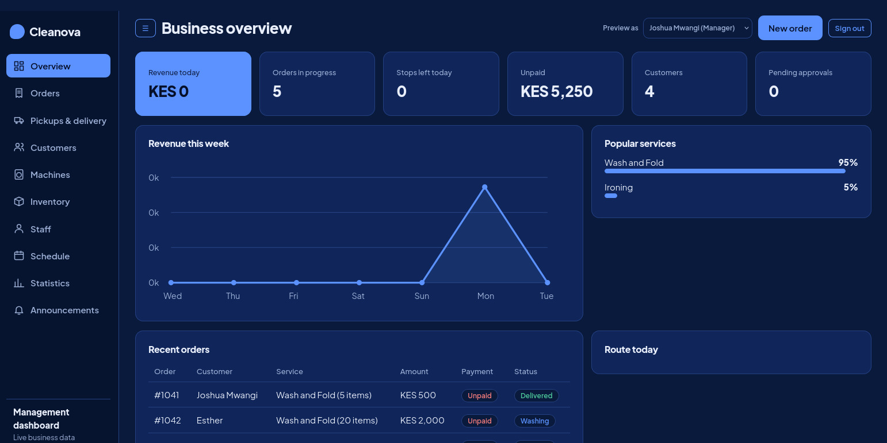

# Cleanova

<p align="center">
  
</p>

<p align="center">
  A modern, business-ready platform for managing laundry orders, customers, payments, branches, staff operations, expenses, and delivery workflows.
</p>

<p align="center">
  <a href="https://cleanova.co.ke">Website</a>
  ·
  <a href="#features">Features</a>
  ·
  <a href="#gallery">Gallery</a>
  ·
  <a href="#technology">Technology</a>
</p>

<p align="center">
  <a href="https://skillicons.dev">
    
  </a>
</p>

---

## About Cleanova

Cleanova is a laundry operations platform designed for businesses that need more than a spreadsheet, a notebook, or a generic point-of-sale system.

It supports the day-to-day reality of a growing laundry business: customers bringing in clothes, online pickup requests, staff handling washing and packaging, payment follow-up, receipt generation, branch management, delivery coordination, inventory-related spending, and owner oversight.

The platform was built with a practical focus: give staff the tools they need to work quickly, while giving owners visibility and approval control over important business actions.

Rather than forcing a laundry business into an overly corporate hierarchy, Cleanova focuses on the people who actually run the shop:

- Owners who oversee branches, staff, approvals, expenses, and business performance.
- Shop managers who coordinate daily orders, customer handovers, washing workflows, and delivery readiness.
- Laundry staff who work through assigned operational tasks.
- Customers who can place orders, track progress, receive updates, and provide feedback.

## Built for real laundry operations

Cleanova is intended for single-shop laundries as well as businesses operating across multiple branches.

The experience is designed around the full customer journey:

1. A customer places an order online or through a shop attendant.
2. The laundry team receives, weighs, processes, and prepares the items.
3. The customer receives payment, order-status, and delivery updates.
4. Staff can issue invoices and receipts when payment is confirmed.
5. Owners can review operational activity, expenses, branch activity, and approvals.

The goal is simple: reduce manual follow-up while keeping the business in control.

## Features

### Customer ordering and tracking

Customers can interact with the public laundry experience without needing access to the internal operations dashboard.

- Online laundry order submission.
- Pickup details and service selection.
- Branch-aware order handling.
- Private tracking code for order progress.
- Secure order-status lookup flow.
- Status updates from received through washing, ready, and delivery.
- Customer feedback and star-rating collection.
- WhatsApp-ready customer communication.

### Operational dashboard

The React dashboard provides a dedicated workspace for owners and shop managers.

- Live order management.
- Customer records and order history.
- Order status progression.
- Payment collection flow.
- M-Pesa payment prompt support.
- Invoice creation and receipt generation.
- Receipt previews and direct PDF downloads.
- Download tracking for invoices and receipts.
- Confirmation prompts for repeated document downloads.
- Expense capture and review.
- Inventory-related expense categories.
- Announcements and promotional customer messaging.
- Responsive layouts for desktop and mobile use.

### Multi-branch support

Cleanova is designed to help a laundry business grow beyond one location.

- Branch details and working-hour management.
- Branch-specific staff assignment.
- Branch-aware orders and riders.
- Owner-level branch visibility.
- Controlled access to business-wide functions.
- Clear separation between daily shop operations and owner oversight.

### Owner controls and approvals

Owners retain control over decisions that may affect financial records or business history.

- Staff profile management.
- Branch management.
- Approval workflows for sensitive changes.
- Expense review and approval.
- Controlled removal requests.
- Business-wide visibility across branches.
- Multiple staff profiles for superusers where needed.

### Expenses and inventory awareness

Laundry businesses have recurring operational costs that deserve proper tracking.

Cleanova supports expense recording for categories such as:

- Electricity.
- Water.
- Transport.
- Detergents.
- Fabric softener.
- Packaging.
- Laundry bags.
- Stain-removal products.
- Staff-related operational costs.
- Other inventory and running expenses.

The focus is not just on recording an amount, but on helping owners understand what keeps each branch running.

### Payments, invoices, and receipts

Payment handling is designed to feel clear for staff and professional for customers.

- Payment prompt workflow.
- Payment-status polling and confirmation state.
- Persistent payment-success receipt options.
- Full invoice and receipt numbering.
- Invoice preview before payment.
- Receipt preview after payment.
- Direct PDF download without opening a separate tab.
- Per-user document download audit history.
- Repeat-download confirmation after two downloads.
- WhatsApp delivery when business credentials are configured.
- Manual PDF-download fallback when WhatsApp delivery is unavailable.

## Gallery

Place showcase images inside the repository’s `images/` directory.

```html
<section id="gallery">
  <h2>Product gallery</h2>

  <details open>
    <summary><strong>Cleanova public ordering experience</strong></summary>
    <br />
    
    <p>Customers can learn about services, submit orders, select a branch, and begin tracking their laundry.</p>
  </details>

  <br />

  <details>
    <summary><strong>Operations dashboard</strong></summary>
    <br />
    
    <p>The dashboard gives shop teams a focused workspace for orders, customers, payments, expenses, and daily operations.</p>
  </details>

  <br />

  <details>
    <summary><strong>Order and payment workflow</strong></summary>
    <br />
    
    <p>Staff can prompt for payment, confirm completed transactions, preview receipts, send them through WhatsApp when configured, or download PDFs.</p>
  </details>

  <br />

  <details>
    <summary><strong>Business administration</strong></summary>
    <br />
    
    <p>Django administration provides a trusted internal workspace for authorised business administration and data management.</p>
  </details>

  <br />

  <details>
    <summary><strong>Mobile-friendly management</strong></summary>
    <br />
    
    <p>The dashboard is designed to remain practical on smaller screens used by managers on the shop floor.</p>
  </details>
</section>

## Technology

Cleanova uses Django for the business foundation and React for the tailored operational experience.

### Django

Django was chosen because it provides reliable, production-minded features out of the box.

- Secure authentication and session handling.
- Built-in protections against common web vulnerabilities.
- Powerful administration tools.
- Mature data validation.
- Database migrations.
- Permission controls.
- Extensible API support.
- Reliable handling of business records and operational data.

Django’s admin interface remains valuable for controlled administration, support, and trusted internal data management.

### React dashboard

The internal dashboard is built separately in React because laundry operations need a faster, more focused interface than a generic administration panel.

The dashboard is shaped around real daily tasks:

- Checking active orders.
- Updating laundry progress.
- Collecting payments.
- Viewing customer history.
- Recording expenses.
- Reviewing receipts.
- Sending customer updates.
- Managing branch activity.

This approach gives users an application experience designed for their work, while Django continues to provide a secure and dependable business foundation.

### Tools and libraries

| Area | Technology |
|---|---|
| Backend | Python, Django |
| API layer | Django REST Framework |
| Dashboard | React |
| Frontend tooling | Vite |
| Styling | CSS |
| Database support | PostgreSQL-ready |
| Payments | M-Pesa integration support |
| Customer communication | WhatsApp-ready workflows |
| Documents | Invoice and receipt PDF generation |
| Administration | Django Admin |
| Source control | Git and GitHub |

## Privacy and security

Cleanova is designed with business and customer privacy in mind.

- Internal operations require authenticated access.
- Dashboard permissions are controlled by the server.
- Sensitive business actions can require owner approval.
- Customer tracking uses a private code rather than exposing full customer details.
- Tracking codes are stored as secure hashes rather than plaintext.
- Invoice and receipt downloads are recorded per authenticated user.
- Repeat document downloads require confirmation after the second download.
- Credentials and deployment configuration are not included in this public showcase repository.

## Deploying for your business

Cleanova is suitable for a laundry business that wants to move from manual records to a more connected workflow.

Before deploying for a business, configure:

- Business name, location, and contact details.
- Branches and working hours.
- Laundry service catalogue and pricing.
- Owner and manager accounts.
- Database settings.
- Payment-provider credentials.
- WhatsApp Business credentials, if direct messaging is required.
- Email settings, if email invoices or receipts are required.
- Production security settings and domain configuration.

> This public repository is a portfolio showcase. Production credentials, private business data, deployment configuration, and protected implementation details are intentionally excluded.

## Why this project matters

Laundry businesses often depend on fragmented tools: paper records, phone calls, WhatsApp chats, spreadsheets, and memory.

Cleanova brings those workflows into one business-focused platform while keeping the experience simple enough for a real shop floor.

It is built to help businesses:

- Reduce missed orders and payment follow-ups.
- Improve customer communication.
- Track work from intake to delivery.
- Keep receipts and invoices organised.
- Understand expenses.
- Support multiple locations.
- Give owners control without slowing down daily operations.
- Create a more professional customer experience.

## Portfolio note

This repository presents the product direction, user experience, and technology choices behind Cleanova.

The private production codebase, sensitive business logic, credentials, infrastructure configuration, and customer data are intentionally not published.

———
<p align="center">
  Built for cleaner operations, happier customers, and growing laundry businesses.
</p>
<p align="center">
  <a href="https://cleanova.co.ke">cleanova.co.ke</a>
</p>
