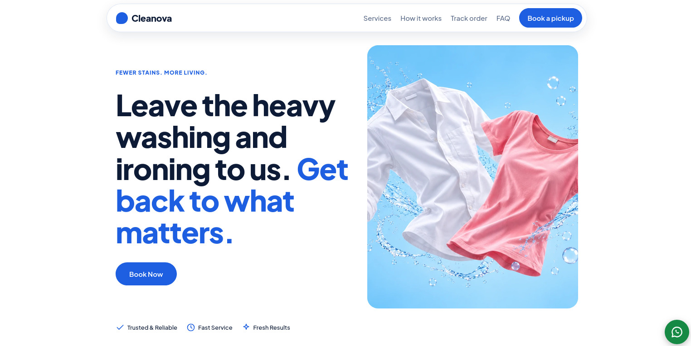
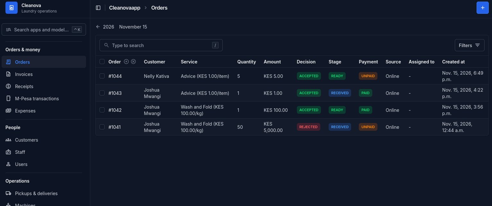
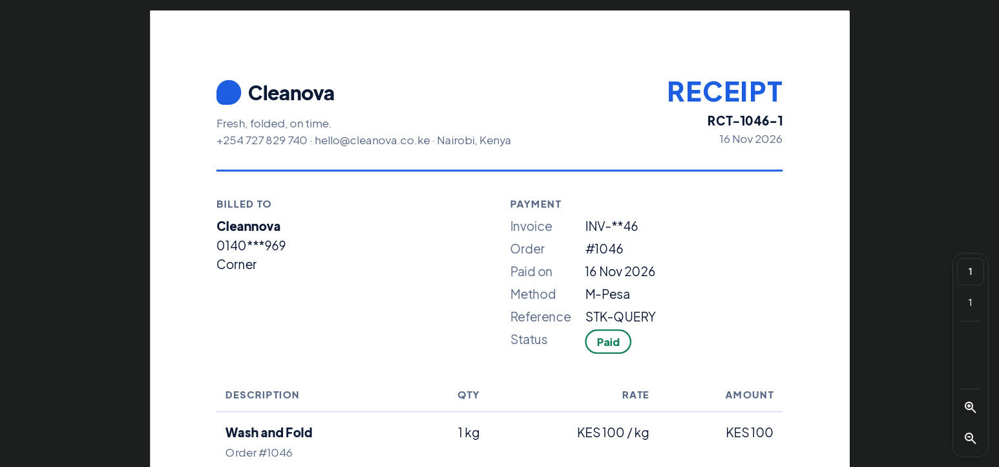
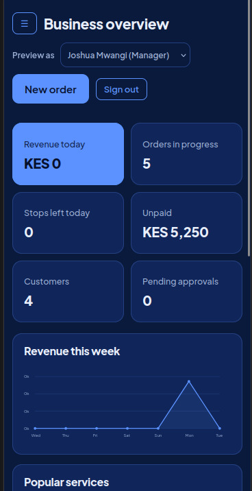

# Cleannova

<p align="center">
  
</p>

<p align="center">
  A modern, business-ready platform for managing laundry orders, customers, payments, branches, staff operations, expenses, and delivery.
</p>

<p align="center">
  <a href="https://www.cleannovalaundry.co.ke">Website</a>
  ·
  <a href="#the-customer-journey">Customer Journey</a>
  ·
  <a href="#features">Features</a>
  ·
  <a href="#gallery">Gallery</a>
  ·
  <a href="#technology">Technology</a>
</p>

<p align="center">
  <a href="https://skillicons.dev">
    
  </a>
</p>

---

## The customer journey

Every order in Cleanova follows one clear path, from the moment a customer hands over their laundry to the moment they leave feedback. Customers always know where their clothes are, and staff always know what comes next.

```
Order placed ---> Tracking code ---> Received and weighed ---> Washing and packaging
                                                                        |
                                                                        v
Feedback <--- Invoice and receipt <--- M-Pesa payment <--- Ready <------
```

| Step | What the customer sees | What happens behind the scenes |
|---|---|---|
| **1. Order** | Submits an order online or hands items to an attendant, picking a service and a branch. | The order appears instantly on the branch dashboard. |
| **2. Track** | Receives a private tracking code and can look up progress at any time. | The code is stored as a secure hash, never as plaintext. |
| **3. Intake** | Gets a confirmation that the items were received. | Staff weigh the items and record the order details. |
| **4. Processing** | Sees the status move through washing and packaging. | The team updates progress, and each change is logged. |
| **5. Ready** | Is told the laundry is ready for pickup or out for delivery. | Riders are assigned per branch where delivery is needed. |
| **6. Payment** | Receives an M-Pesa prompt and approves it on their phone. | The system polls for the result and shows a clear confirmation. |
| **7. Documents** | Gets a numbered invoice and receipt, by WhatsApp or as a PDF. | Every download is recorded per user for audit. |
| **8. Feedback** | Leaves a star rating and a short comment. | Owners see the feedback alongside branch performance. |

---

## About Cleanova

Cleanova is a laundry operations platform for businesses that have outgrown spreadsheets, notebooks, and generic point-of-sale systems. It supports the daily reality of a growing laundry: customers dropping off clothes, online pickup requests, washing and packaging, payment follow-up, receipts, branch management, delivery coordination, running costs, and owner oversight.

The platform was built with a practical goal. Staff get tools that let them work quickly, and owners get visibility and approval control over the actions that matter. Instead of forcing a laundry into a heavy corporate hierarchy, Cleanova is organised around the people who actually run the shop. Owners oversee branches, staff, approvals, expenses, and performance. Shop managers coordinate daily orders, customer handovers, washing, and delivery readiness. Laundry staff work through their assigned tasks, and customers can place orders, track progress, receive updates, and leave feedback.

Cleanova works for a single shop or a business with several branches. The aim throughout is to reduce manual follow-up while keeping the business firmly in control.

## Features

### Customer ordering and tracking

Customers use the public side of Cleanova without ever touching the internal dashboard. They can submit an order online, choose a service, enter pickup details, and select a branch. Each order gets a private tracking code, which customers use through a secure lookup to follow their laundry from received, through washing and ready, to delivery. Once the order is complete, they can leave a star rating and written feedback, and all communication is WhatsApp-ready.

### Operational dashboard

The React dashboard gives owners and shop managers a focused workspace for live order management, customer records and history, and moving orders through each status. Staff can collect payments, including M-Pesa payment prompts, and create invoices and receipts with on-screen previews and direct PDF downloads. The dashboard also covers expense capture, announcements and promotional messages to customers, and layouts that stay comfortable on both desktop and mobile.

### Multi-branch support

As a business grows beyond one location, Cleanova keeps each branch organised. Every branch has its own details and working hours, and staff, orders, and riders are all branch-aware. Owners see across every branch and keep control of business-wide functions, while daily shop operations stay clearly separated from owner oversight.

### Owner controls and approvals

Owners keep the final say on decisions that affect financial records or business history. They manage staff profiles and branches, review and approve expenses, and handle removal requests through a controlled approval process. Sensitive changes can be routed through approval workflows, and superusers can hold multiple staff profiles where the business needs it.

### Expenses and inventory awareness

Every laundry has recurring costs that deserve proper tracking. Cleanova records expenses for electricity, water, transport, detergents, fabric softener, packaging, laundry bags, stain-removal products, staff-related costs, and other running expenses. The point isn't only to log an amount, but to help owners understand what keeps each branch running.

### Payments, invoices, and receipts

Payment handling is designed to feel clear for staff and professional for customers. Staff send a payment prompt, and the system polls for the result and shows a clear confirmation state, with receipt options that stay on screen after success. Invoices and receipts are fully numbered, with a preview before payment and another after it. PDFs download directly without opening a new tab, and every download is recorded per user, with a confirmation prompt on the third attempt. Documents can be sent over WhatsApp when business credentials are configured, with manual PDF download as a fallback when they aren't.

## Gallery

<table align="center">
  <tr>
    <td width="50%" valign="top" align="center">
      
      <br />
      <strong>Operations dashboard</strong>
      <br />
      <sub>A focused workspace for orders, customers, payments, and expenses.</sub>
      <br /><br />
      
      <br />
      <strong>Business administration</strong>
      <br />
      <sub>A trusted internal workspace for authorised data management.</sub>
    </td>
    <td width="50%" valign="top" align="center">
      
      <br />
      <strong>Payment and receipts</strong>
      <br />
      <sub>Prompt for payment, confirm it, preview receipts, and send or download PDFs.</sub>
      <br /><br />
      
      <br />
      <strong>Mobile management</strong>
      <br />
      <sub>Practical on the smaller screens managers use on the shop floor.</sub>
    </td>
  </tr>
</table>

## Technology

Cleanova uses Django for the business foundation and React for a tailored operational experience.

Django was chosen for its production-minded defaults: secure authentication and sessions, built-in protection against common web vulnerabilities, mature data validation, migrations, permission controls, and extensible API support. Its admin interface also remains valuable for support and trusted internal data management.

The internal dashboard is a separate React app because laundry work needs something faster and more focused than a generic admin panel. It is shaped around daily tasks such as checking active orders, updating progress, collecting payments, reviewing customer history, recording expenses, sending updates, and managing branch activity. Users get an interface built for their work, while Django continues to provide a dependable and secure backend.

| Area | Technology |
|---|---|
| Backend | Python, Django |
| API layer | Django REST Framework |
| Dashboard | React, Vite |
| Styling | CSS |
| Database | PostgreSQL-ready |
| Payments | M-Pesa integration |
| Communication | WhatsApp-ready workflows |
| Documents | Invoice and receipt PDF generation |
| Administration | Django Admin |
| Source control | Git and GitHub |

## Privacy and security

Cleanova is designed with business and customer privacy in mind. All internal operations require authenticated access, and dashboard permissions are enforced by the server. Sensitive business actions can require owner approval. Customers are identified by a private tracking code rather than exposed personal details, and those codes are stored as secure hashes, never as plaintext. Invoice and receipt downloads are logged per authenticated user, with confirmation required on repeat downloads. Credentials and deployment configuration are not part of this public showcase.

## Deploying for your business

Cleanova suits any laundry that wants to move from manual records to a connected workflow. Before going live, a deployment is configured with the business name, location, and contact details, along with branches, working hours, the service catalogue, and pricing. It also needs owner and manager accounts, database settings, payment-provider credentials, and production security and domain configuration. WhatsApp Business credentials and email settings are added only if direct messaging or emailed documents are needed.

> This public repository is a portfolio showcase. Production credentials, private business data, deployment configuration, and protected implementation details are intentionally excluded.

## Why this project matters

Laundry businesses often rely on fragmented tools: paper records, phone calls, WhatsApp chats, spreadsheets, and memory. Cleanova brings those workflows into one platform that is still simple enough for a busy shop floor. It helps businesses cut down on missed orders and payment follow-ups, communicate better with customers, track work from intake to delivery, keep documents organised, understand their expenses, and support multiple locations, all while giving owners control without slowing daily operations.

## Portfolio note

This repository presents the product direction, user experience, and technology choices behind Cleanova. The private production codebase, sensitive business logic, credentials, infrastructure configuration, and customer data are intentionally not published.

---

<p align="center">
  Built for cleaner operations, happier customers, and growing laundry businesses.
</p>
<p align="center">
  <a href="https://www.cleannovalaundry.co.ke">www.cleannovalaundry.co.ke</a>
</p>
